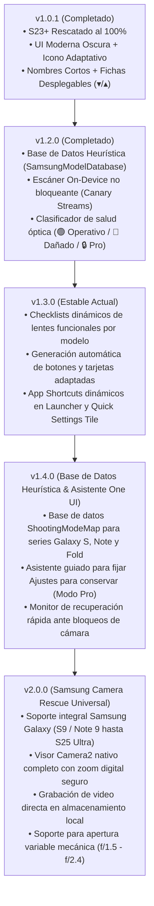

# Hoja de Ruta y Especificación Técnica — Samsung Camera Rescue

Este documento define la planificación técnica, límites de compatibilidad de hardware, requisitos de permisos y alcance funcional para las versiones de **Camera Rescue** (actualmente implementada en su versión estable `v1.3.0`).

El proyecto se enfoca **exclusivamente en el ecosistema de dispositivos móviles Samsung Galaxy**, especializándose en superar las particularidades de su arquitectura de cámara propietaria (proveedor HAL `vendor.samsung.hardware.camera.provider`, servicio `cameraserver` con restricción de `cameraId >= 20`, tabla interna `ShootingModeMap` y capa One UI).

---

## 🗺️ Mapa de Versiones y Hitos de Desarrollo

---

## 📱 Matriz de Compatibilidad de Hardware y Versiones de Android / One UI

El alcance del proyecto cubre desde los primeros dispositivos Samsung con arreglos de cámaras múltiples y aperturas mecánicas hasta los flagships más recientes:

| Generación Samsung | Modelos Representativos | Versión Android / One UI Soportada | Arquitectura de Cámara | Particularidades y Estrategia de Rescate |
| :--- | :--- | :--- | :--- | :--- |
| **Galaxy S9 / S9+ / Note 9** | `SM-G960`, `SM-G965`, `SM-N960` | Android 8.0 (Oreo) hasta **Android 10 (One UI 2.5)** | • S9: 1 trasera (Gran Angular 12 MP con apertura mecánica dual $f/1.5 \leftrightarrow f/2.4$). • S9+ / Note 9: 2 traseras (12 MP 1x + 12 MP 2x Tele). | **Restricción de SO:** Android 10 no cuenta con `AccessibilityService.takeScreenshot()` (introducido en Android 11). El rescate trasero en estos modelos opera mediante **Modo Pro nativo directo** o visor `Camera2` propio de la v2.0 con control del diafragma mecánico. |
| **Galaxy S10 / Note 10** | `SM-G970`, `SM-G973`, `SM-G975`, `SM-N970`, `SM-N975` | Android 9.0 (One UI 1.0) hasta **Android 12 (One UI 4.1)** | Arreglo triple: Ultra-Wide (16 MP) + Wide 1x (12 MP apertura dual) + Telefoto (12 MP 2x). | Introducción de triple lente. En Android 11 y 12 soporta el 100% de las funciones (HUD flotante, Pro directo y visor integrado). |
| **Galaxy S20 / S21 / S22 Series** | `SM-G98x`, `SM-G99x`, `SM-S90x` | Android 10 (One UI 2.0) hasta **Android 15 (One UI 7)** | Sensores de alta resolución (64 MP / 108 MP) + Ultra-Wide + Telefoto 3x / Periscopio 10x. | Introducción de `BACK_SEAMLESS_ZOOM` (`device 20`). Fallos comunes en Ultra-Wide o Periscopio tras caídas. Bypass probado mediante `ShootingMode 3` (Pro) y `40` (QR). |
| **Galaxy S23 / S24 / S25 Series** | `SM-S91x`, `SM-S92x`, `SM-S93x` | Android 13 (One UI 5.1) hasta **Android 16+ (One UI 8+)** | Sensores GN3 (50 MP) / HP2 (200 MP) + IMX564 (Ultra-Wide) + 3x / 5x Tele. | **Arquitectura de referencia del proyecto.** Solución completa verificada en hardware real (`SM-S916U1`). |
| **Galaxy Note 20 / Note 20 Ultra** | `SM-N980`, `SM-N985`, `SM-N986` | Android 10 hasta **Android 13 (One UI 5.0)** | 108 MP / 12 MP + Ultra-Wide + Periscopio 5x con enfoque láser. | Compatible con desacoplamiento de láser AF y rescate de sensores independientes. |
| **Galaxy Z Fold / Z Flip (1 al 6)** | `SM-F9xx`, `SM-F7xx` | Android 10 hasta **Android 16+** | Cámaras de pantalla externa, trasera triple y cámara bajo pantalla (UDC). | Aislamiento de fallos en cable flex de bisagra o sensores secundarios. |
| **Galaxy A Series (A51 a A55, A71 a A73)** | `SM-A5xx`, `SM-A7xx` | Android 10 hasta **Android 15+** | Arreglos cuádruples económicos (Wide + Ultra-Wide + Macro + Profundidad). | Fallas frecuentes de sensor Macro/Ultra-Wide que colapsan la app nativa; rescate directo del sensor principal. |

---

## 📋 Matriz de Resumen por Versión

| Versión | Alcance | Hito Principal | Dependencia de Depuración USB |
| :--- | :--- | :--- | :--- |
| **`v1.0.1`** | Samsung S23+ | **Completado**: Rescate IDs 56, 52, 1, 3, UI moderna oscura, icono adaptativo, tarjetas técnicas ▾/▴. | Ninguna para uso diario (solo se usó en el diagnóstico inicial). |
| **`v1.2.0`** | Familia Samsung Galaxy | **Completado**: Escaneo canary on-device de sensores, base de datos heurística de modelos Samsung (`SamsungModelDatabase`), reporte visual de salud de cada lente. | Ninguna (100% en dispositivo). |
| **`v1.3.0`** | Familia Samsung Galaxy | **Estable actual**: Checklist interactivo de sensores (`SensorSelectionState`), UI dinámica (`DynamicUiBuilder`), App Shortcuts (`RescueShortcutManager`) y Quick Settings Tile (`CameraRescueTileService`). | Ninguna (100% en celular). |
| **`v1.4.0`** | Familia Samsung Galaxy | **Auto-Matcher One UI**: Diccionario heurístico de modos Pro/QR por modelo y asistente de tecla lateral. | Ninguna (Base de datos pre-compilada). |
| **`v2.0.0`** | Ecosistema Samsung (S9 a S25+) | **Universal Samsung Rescue**: Visor completo nativo, diafragma mecánico variable, zoom digital por software y video MP4. | Ninguna (Completamente autónomo). |
