# Hoja de Ruta y Especificación Técnica — Rescue Cam: Sensor Recovery

> **Aviso de Independencia:** *Rescue Cam es una utilidad independiente. No está afiliada, autorizada, respaldada ni conectada con Samsung Electronics Co., Ltd. Los términos «Samsung», «Galaxy» y «One UI» se emplean únicamente con fines descriptivos de compatibilidad de hardware.*

Este documento define la planificación técnica, límites de compatibilidad de hardware, requisitos de permisos y alcance funcional para **Rescue Cam: Sensor Recovery** (`io.github.benedetto597.rescuecam`, versión estable actual **`v2.1.0`**).

El proyecto se enfoca en superar las particularidades del subsistema de cámara en dispositivos Samsung Galaxy (proveedor HAL `vendor.samsung.hardware.camera.provider`, servicio `cameraserver` con restricción de `cameraId >= 20`, tabla interna `ShootingModeMap` y capa One UI).

---

## 🗺️ Mapa de Versiones y Hitos de Desarrollo

```mermaid
flowchart TD
    v101["v1.0.1 (Completado)<br/>• S23+ Rescatado al 100%<br/>• UI Moderna Oscura + Icono Adaptativo<br/>• Nombres Cortos + Fichas Desplegables (▾/▴)"]
    
    v120["v1.2.0 (Completado)<br/>• Base de Datos Heurística (SamsungModelDatabase)<br/>• Escáner On-Device no bloqueante (Canary Streams)<br/>• Clasificador de salud óptica (🟢 Operativo / 🔴 Dañado / 🔒 Pro)"]
    
    v130["v1.3.0 (Completado)<br/>• Checklists dinámicos de lentes funcionales por modelo<br/>• Generación automática de botones y tarjetas adaptadas<br/>• App Shortcuts dinámicos en Launcher y Quick Settings Tile"]
    
    v140["v1.4.0 (Completado)<br/>• Catálogo S9-S25/FE/Note/Fold/Flip/A + ShootingModeMap One UI 2..8+<br/>• Asistente guiado para Ajustes para conservar y Tecla lateral<br/>• Motor de recuperación rápida escalonada ante bloqueos HAL"]
    
    v200["v2.0.0 (Completado — Camera Rescue Universal)<br/>• Visor Camera2 nativo completo (frontales + traseros públicos)<br/>• Zoom seguro, EV, flash/linterna, timer, cuadrícula y apertura f/1.5-f/2.4<br/>• Video MP4 transaccional en MediaStore + perfiles .json vía SAF"]

    v210["v2.1.0 (Estable Actual — Play Store Readiness)<br/>• Branding libre de marcas registradas (Rescue Cam: Sensor Recovery)<br/>• Arquitectura Cero-Accesibilidad + targetSdk = 36 + Edge-to-Edge<br/>• Política de Privacidad estática, Data Safety offline y build AAB seguro"]

    v101 --> v120
    v120 --> v130
    v130 --> v140
    v140 --> v200
    v200 --> v210
```

---

## 📱 Matriz de Compatibilidad de Hardware y Versiones de Android / One UI

El alcance técnico cubre desde los primeros dispositivos Samsung con arreglos de cámaras múltiples y aperturas mecánicas hasta los flagships recientes:

| Generación Samsung | Modelos Representativos | Versión Android / One UI Soportada | Arquitectura de Cámara | Particularidades y Estrategia de Rescate |
| :--- | :--- | :--- | :--- | :--- |
| **Galaxy S9 / S9+ / Note 9** | `SM-G960`, `SM-G965`, `SM-N960` | Android 8.0 (Oreo) hasta **Android 10 (One UI 2.5)** | • S9: 1 trasera (Gran Angular 12 MP con apertura mecánica dual $f/1.5 \leftrightarrow f/2.4$). • S9+ / Note 9: 2 traseras (12 MP 1x + 12 MP 2x Tele). | Rescate trasero mediante **Modo Pro nativo directo** o el **visor `Camera2` universal** con control del diafragma mecánico (`LENS_APERTURE`). |
| **Galaxy S10 / Note 10** | `SM-G970`, `SM-G973`, `SM-G975`, `SM-N970`, `SM-N975` | Android 9.0 (One UI 1.0) hasta **Android 12 (One UI 4.1)** | Arreglo triple: Ultra-Wide (16 MP) + Wide 1x (12 MP apertura dual) + Telefoto (12 MP 2x). | Soporta Modo Pro directo, Escáner QR 1x y visor `Camera2` universal con `LENS_APERTURE` $f/1.5 \leftrightarrow f/2.4$. |
| **Galaxy S20 / S21 / S22 Series** | `SM-G98x`, `SM-G99x`, `SM-S90x` | Android 10 (One UI 2.0) hasta **Android 15 (One UI 7)** | Sensores de alta resolución (64 MP / 108 MP) + Ultra-Wide + Telefoto 3x / Periscopio 10x. | Bypass probado mediante `ShootingMode 3` (Pro), `36` (Video Pro) y `40` (Escáner QR 1x). |
| **Galaxy S23 / S24 / S25 Series** | `SM-S91x`, `SM-S92x`, `SM-S93x` | Android 13 (One UI 5.1) hasta **Android 16+ (One UI 8+)** | Sensores GN3 (50 MP) / HP2 (200 MP) + IMX564 (Ultra-Wide) + 3x / 5x Tele. | **Arquitectura de referencia del proyecto.** Solución verificada en hardware real (`SM-S916U1`). |
| **Galaxy Note 20 / Note 20 Ultra** | `SM-N980`, `SM-N985`, `SM-N986` | Android 10 hasta **Android 13 (One UI 5.0)** | 108 MP / 12 MP + Ultra-Wide + Periscopio 5x con enfoque láser. | Desacoplamiento de láser AF y rescate de sensores independientes. |
| **Galaxy Z Fold / Z Flip (1 al 6)** | `SM-F9xx`, `SM-F7xx` | Android 10 hasta **Android 16+** | Cámaras de pantalla externa, trasera triple y cámara bajo pantalla (UDC). | Soporte adaptativo (`resizeableActivity="true"`, sin bloqueo portrait) y aislamiento de fallos en flex de bisagra. |
| **Galaxy A Series (A51 a A55, A71 a A73)** | `SM-A5xx`, `SM-A7xx` | Android 10 hasta **Android 15+** | Arreglos cuádruples (Wide + Ultra-Wide + Macro + Profundidad). | Rescate directo del sensor principal y visor `Camera2` cuando el sensor público está operativo. |

---

## 📋 Matriz de Resumen por Versión

| Versión | Alcance | Hito Principal | Dependencia de Depuración USB |
| :--- | :--- | :--- | :--- |
| **`v1.0.1`** | Dispositivo S23+ | **Completado**: Rescate IDs 56, 52, 1, 3, UI moderna oscura, icono adaptativo, tarjetas técnicas ▾/▴. | Ninguna para uso diario (solo en diagnóstico inicial). |
| **`v1.2.0`** | Familia Galaxy | **Completado**: Escaneo canary on-device de sensores, base de datos heurística (`SamsungModelDatabase`), reporte visual de salud. | Ninguna (100% en dispositivo). |
| **`v1.3.0`** | Familia Galaxy | **Completado**: Checklist interactivo (`SensorSelectionState`), UI dinámica (`DynamicUiBuilder`), App Shortcuts y Quick Settings Tile. | Ninguna (100% en dispositivo). |
| **`v1.4.0`** | Familia Galaxy (`S9–S25 / Z / A`) | **Completado**: Catálogo ampliado, mapeador `ShootingModeMap` One UI `2.x`–`8+`, asistente `OneUiAssistantGuide` y `CameraRecoveryEngine`. | Ninguna (Base de datos pre-compilada). |
| **`v2.0.0`** | Ecosistema Galaxy (`S9 a S25+`) | **Completado**: Visor `Camera2` universal, zoom digital seguro, EV/flash/timer/cuadrícula, apertura $f/1.5 \leftrightarrow f/2.4$, video MP4 y perfiles `.json` SAF. | Ninguna (Completamente autónomo). |
| **`v2.1.0`** | **Play Store Readiness** | **Estable actual**: `Rescue Cam: Sensor Recovery` (`io.github.benedetto597.rescuecam`), arquitectura cero-accesibilidad, `targetSdk = 36` + edge-to-edge, Política de Privacidad estática, `PlayStoreCompliancePolicy`, R8/ProGuard y pipeline seguro APK/AAB. | Ninguna. |
