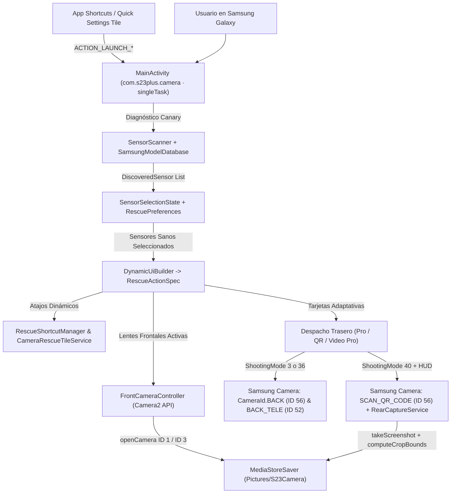

# Arquitectura de Software — Camera Rescue (`com.s23plus.camera` · `v1.3.0`)

**Repositorio Oficial:** `https://github.com/benedetto597/camera-rescue`

## 1. Diagrama de Flujo y Ruteo de Sensores

---

## 2. Responsabilidades por Módulo

| Archivo | Responsabilidad |
| :--- | :--- |
| [`CameraConfig.java`](../app/src/main/java/com/s23plus/camera/CameraConfig.java) | Constantes inmutables de hardware (`ID 1`, `ID 3`, `ID 56`, `ID 52`), acciones de Intent (`ACTION_LAUNCH_*`, `SCAN_QR_CODE`) y cálculo geométrico puro (`computeCropBounds`) cubierto por pruebas unitarias. |
| [`SamsungModelDatabase.java`](../app/src/main/java/com/s23plus/camera/SamsungModelDatabase.java) | Catálogo heurístico offline de modelos Samsung Galaxy (`Build.MODEL`) con perfiles de sensores e IDs independientes. |
| [`SensorHealth.java`](../app/src/main/java/com/s23plus/camera/SensorHealth.java) | Clasificación de salud física (`HEALTHY`, `DAMAGED`, `HAL_PRIVATE`, `UNKNOWN`). |
| [`DiscoveredSensor.java`](../app/src/main/java/com/s23plus/camera/DiscoveredSensor.java) | Ficha descriptiva inmutable de cada sensor detectado (`facing`: `0 = BACK`, `1 = FRONT`). |
| [`SensorScanner.java`](../app/src/main/java/com/s23plus/camera/SensorScanner.java) | Escáner on-device no bloqueante en `HandlerThread` con prueba canary por cámara, timeout de seguridad y deduplicación de IDs independientes. |
| [`RescueActionSpec.java`](../app/src/main/java/com/s23plus/camera/RescueActionSpec.java) | Especificación inmutable de tarjetas de acción y accesos directos (`ActionType`, colores, descripciones técnicas y `intentAction`). |
| [`SensorSelectionState.java`](../app/src/main/java/com/s23plus/camera/SensorSelectionState.java) | Lógica pura de elegibilidad de sensores sanos, saneamiento de selección y serialización determinista. |
| [`DynamicUiBuilder.java`](../app/src/main/java/com/s23plus/camera/DynamicUiBuilder.java) | Motor puro que genera tarjetas traseras, lista frontal activa y atajos dinámicos según perfil del modelo o selección post-escaneo. |
| [`RescuePreferences.java`](../app/src/main/java/com/s23plus/camera/RescuePreferences.java) | Persistencia local en `SharedPreferences` para sensores seleccionados y acción configurada en el Quick Settings Tile. |
| [`RescueShortcutManager.java`](../app/src/main/java/com/s23plus/camera/RescueShortcutManager.java) | Publicación de App Shortcuts dinámicos (hasta 4) y solicitud de atajos fijados vía `ShortcutManager`. |
| [`CameraRescueTileService.java`](../app/src/main/java/com/s23plus/camera/CameraRescueTileService.java) | Servicio de Quick Settings Tile compatible con Android 11–16 (usa `PendingIntent` en API 34+ y fallback heredado en API 30–33). |
| [`FrontCameraController.java`](../app/src/main/java/com/s23plus/camera/FrontCameraController.java) | Gestión del ciclo de vida de `Camera2` (`CameraDevice`, `CameraCaptureSession`, `ImageReader`, `HandlerThread`) para cámaras frontales activas. |
| [`RearCaptureService.java`](../app/src/main/java/com/s23plus/camera/RearCaptureService.java) | HUD flotante (`TYPE_ACCESSIBILITY_OVERLAY`) y captura instantánea del visor trasero `ID 56` mediante `takeScreenshot(Display.DEFAULT_DISPLAY, ...)`. |
| [`MediaStoreSaver.java`](../app/src/main/java/com/s23plus/camera/MediaStoreSaver.java) | Persistencia transaccional de imágenes JPEG en `Pictures/S23Camera` utilizando `IS_PENDING`. |
| [`MainActivity.java`](../app/src/main/java/com/s23plus/camera/MainActivity.java) | Interfaz principal con diagnóstico interactivo, checklist de sensores, tarjetas adaptativas, control de atajos/tile y consumo seguro de intents en `singleTask`. |
