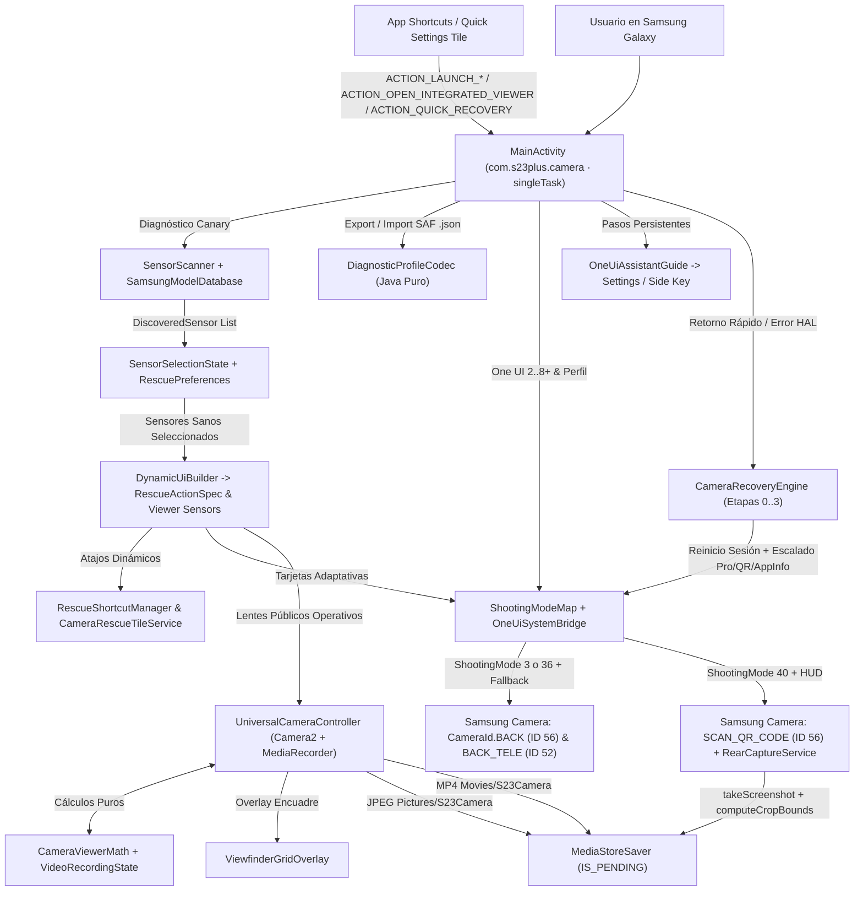

# Arquitectura de Software — Camera Rescue (`com.s23plus.camera` · `v2.0.0`)

**Repositorio Oficial:** `https://github.com/benedetto597/camera-rescue`

## 1. Diagrama de Flujo y Ruteo de Sensores

---

## 2. Responsabilidades por Módulo

| Archivo | Responsabilidad |
| :--- | :--- |
| [`CameraConfig.java`](../app/src/main/java/com/s23plus/camera/CameraConfig.java) | Constantes inmutables de hardware (`ID 1`, `ID 3`, `ID 56`, `ID 52`), rutas `MediaStore` (`Pictures/S23Camera`, `Movies/S23Camera`), acciones de Intent (`ACTION_LAUNCH_*`, `ACTION_OPEN_INTEGRATED_VIEWER`, `ACTION_QUICK_RECOVERY`, `SCAN_QR_CODE`), umbrales (`RAPID_RETURN_LOCKUP_THRESHOLD_MS`, `MIN_VALID_VIDEO_DURATION_MS`, `PROFILE_SCHEMA_VERSION`) y cálculo geométrico puro (`computeCropBounds`). |
| [`SamsungModelDatabase.java`](../app/src/main/java/com/s23plus/camera/SamsungModelDatabase.java) | Catálogo heurístico offline ampliado (Galaxy S9–S25, FE, Note 9–20, Z Fold/Flip 1–6 y Serie A) con perfiles de sensores, soporte nativo de Video Pro, apertura variable, riesgo de bisagra y notas técnicas. |
| [`ShootingModeMap.java`](../app/src/main/java/com/s23plus/camera/ShootingModeMap.java) | Motor puro Java que detecta la generación de One UI (`2.x`–`8+`) y resuelve `ModeDescriptor` con variantes ordenadas de lanzamiento y respaldo (`PRO_PHOTO`, `PRO_VIDEO`, `QR_SCANNER`). |
| [`OneUiAssistantGuide.java`](../app/src/main/java/com/s23plus/camera/OneUiAssistantGuide.java) | Lógica pura del asistente guiado de 4 pasos adaptado por modelo y One UI para fijar *Ajustes para conservar* y *Tecla/Botón lateral (doble toque)*, con progreso y serialización determinista. |
| [`CameraRecoveryEngine.java`](../app/src/main/java/com/s23plus/camera/CameraRecoveryEngine.java) | Motor puro de detección de retorno rápido/bloqueo HAL (`isSuspectedCrashReturn`, `isCamera2LockupError`, `isCameraErrorMessageLockup`) y planes de recuperación escalonada (`0`..`3`). |
| [`CameraViewerMath.java`](../app/src/main/java/com/s23plus/camera/CameraViewerMath.java) | Lógica pura de visor `Camera2`: estrategia de zoom (`CONTROL_ZOOM_RATIO` en API 30+ vs `SCALER_CROP_REGION`), compensación EV, modos de flash/linterna, temporizador, cuadrícula, apertura variable mecánica (`LENS_APERTURE` $f/1.5 \leftrightarrow f/2.4$), orientación por facing y selección de resolución de video. |
| [`VideoRecordingState.java`](../app/src/main/java/com/s23plus/camera/VideoRecordingState.java) | Máquina de estados pura y sincronizada para grabación MP4 (`IDLE` → `PREPARING` → `RECORDING` → `STOPPING` → `IDLE`), decisión de permiso `RECORD_AUDIO` con degradación limpia a video sin audio, formato de contador y duración mínima válida (`600 ms`). |
| [`DiagnosticProfileCodec.java`](../app/src/main/java/com/s23plus/camera/DiagnosticProfileCodec.java) | Codificador y parser recursivo descendente RFC-8259 en Java puro (sin `org.json`) para exportar/importar perfiles `.json` offline con validación estricta de esquema, límites de tamaño/sensores, claves duplicadas y lista blanca de acciones de Tile/Shortcut. |
| [`OneUiSystemBridge.java`](../app/src/main/java/com/s23plus/camera/OneUiSystemBridge.java) | Puente Android SDK para leer `SEM_PLATFORM_INT`, construir/lanzar variantes de `ShootingModeMap` con respaldo automático y abrir Ajustes de Cámara, Tecla Lateral o App Info. |
| [`SensorHealth.java`](../app/src/main/java/com/s23plus/camera/SensorHealth.java) | Clasificación de salud física (`HEALTHY`, `DAMAGED`, `HAL_PRIVATE`, `UNKNOWN`). |
| [`DiscoveredSensor.java`](../app/src/main/java/com/s23plus/camera/DiscoveredSensor.java) | Ficha descriptiva inmutable de cada sensor detectado (`facing`: `0 = BACK`, `1 = FRONT`). |
| [`SensorScanner.java`](../app/src/main/java/com/s23plus/camera/SensorScanner.java) | Escáner on-device no bloqueante en `HandlerThread` con prueba canary por cámara, timeout de seguridad y deduplicación de IDs independientes. |
| [`RescueActionSpec.java`](../app/src/main/java/com/s23plus/camera/RescueActionSpec.java) | Especificación inmutable de tarjetas de acción y accesos directos (`ActionType`, colores, descripciones técnicas y `intentAction`). |
| [`SensorSelectionState.java`](../app/src/main/java/com/s23plus/camera/SensorSelectionState.java) | Lógica pura de elegibilidad de sensores sanos, saneamiento de selección y serialización determinista. |
| [`DynamicUiBuilder.java`](../app/src/main/java/com/s23plus/camera/DynamicUiBuilder.java) | Motor puro que genera tarjetas traseras, lista frontal activa, lista unificada de sensores públicos operativos para el visor (`getSelectablePublicViewerSensors`) y atajos dinámicos. |
| [`RescuePreferences.java`](../app/src/main/java/com/s23plus/camera/RescuePreferences.java) | Persistencia local en `SharedPreferences` para sensores seleccionados, acción del Quick Settings Tile, pasos del Asistente One UI y preferencias del visor universal (`ViewerPreferencesSnapshot`). |
| [`RescueShortcutManager.java`](../app/src/main/java/com/s23plus/camera/RescueShortcutManager.java) | Publicación de App Shortcuts dinámicos (hasta 4) y solicitud de atajos fijados vía `ShortcutManager`. |
| [`CameraRescueTileService.java`](../app/src/main/java/com/s23plus/camera/CameraRescueTileService.java) | Servicio de Quick Settings Tile compatible con Android 11–16 (usa `PendingIntent` en API 34+ y fallback heredado en API 30–33). |
| [`UniversalCameraController.java`](../app/src/main/java/com/s23plus/camera/UniversalCameraController.java) | Controlador unificado `Camera2` + `MediaRecorder` para sensores frontales y traseros públicos operativos con zoom, EV, flash/linterna, apertura variable `LENS_APERTURE`, foto JPEG y video MP4 transaccional. |
| [`ViewfinderGridOverlay.java`](../app/src/main/java/com/s23plus/camera/ViewfinderGridOverlay.java) | Superposición ligera de guías de encuadre (`OFF`, `RULE_OF_THIRDS` 3x3 y `CROSSHAIR`) sin asignaciones en `onDraw`. |
| [`RearCaptureService.java`](../app/src/main/java/com/s23plus/camera/RearCaptureService.java) | HUD flotante (`TYPE_ACCESSIBILITY_OVERLAY`) y captura instantánea del visor trasero `ID 56` mediante `takeScreenshot(Display.DEFAULT_DISPLAY, ...)`. |
| [`MediaStoreSaver.java`](../app/src/main/java/com/s23plus/camera/MediaStoreSaver.java) | Persistencia transaccional en `MediaStore` con `IS_PENDING`: fotografías JPEG en `Pictures/S23Camera` y sesiones de video MP4 (`PendingVideoSession`) en `Movies/S23Camera` con publicación/aborto atómico. |
| [`MainActivity.java`](../app/src/main/java/com/s23plus/camera/MainActivity.java) | Interfaz principal con diagnóstico interactivo, checklist de sensores, visor universal `Camera2` con controles en vivo y temporizador, grabación MP4 degradable sin audio, exportación/importación `.json` vía SAF, recuperación rápida de bloqueos, asistente One UI y atajos/tile. |
